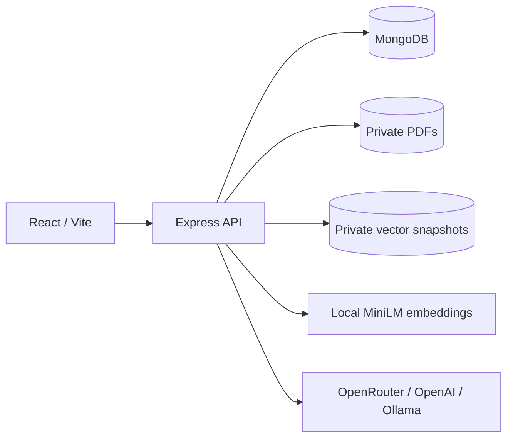

# SAGE — AI PDF Chatbot

SAGE lets a signed-in user upload a text-based PDF and ask questions about it. The backend extracts text, splits it into chunks, creates local MiniLM embeddings, retrieves relevant chunks with exact cosine search, and asks a configured LLM to answer from that evidence. Conversations and document metadata live in MongoDB.

## What works

- JWT registration/login, per-user document and conversation routes.
- PDF upload with size, MIME/extension, and byte-signature checks.
- Local embeddings with private vector snapshots for restart recovery on durable disk.
- Document chat through OpenRouter, OpenAI, Ollama, or a mock provider.
- Conversation history, feedback, document deletion, and a responsive React UI.
- Backend unit tests, frontend lint/build, and GitHub Actions CI configuration.

The app currently processes uploads in the HTTP request and does not support scanned-PDF OCR. Newly processed text PDFs carry page numbers in retrieved sources; older saved indexes may need reprocessing to gain them. LLM answers are returned as complete JSON, not streamed. Review [security](docs/SECURITY.md) and [performance evidence](docs/PERFORMANCE.md) before production deployment.

## Architecture



See [architecture](docs/ARCHITECTURE.md), [RAG pipeline](docs/RAG_PIPELINE.md), and [engineering decisions](docs/ENGINEERING_DECISIONS.md).

## Local development

Requirements: Node 22+, MongoDB, and a provider key unless `LLM_PROVIDER=mock` or a local Ollama server is used.

```bash
cd backend
npm ci
cp .env.example .env
# Edit .env: set MONGODB_URI, a unique strong JWT_SECRET, FRONTEND_URL, and provider settings.
npm run dev
```

In another terminal:

```bash
cd frontend
npm ci
cp .env.example .env
npm run dev
```

The backend defaults to port 5000 and the Vite frontend to port 5173. Keep `UPLOAD_DIR` and `VECTOR_INDEX_DIR` on private durable storage. No keys belong in `VITE_` variables. For deployment and rollback, see [deployment](docs/DEPLOYMENT.md).

## API overview

Authenticated routes require `Authorization: Bearer <token>`.

| Purpose | Routes |
|---|---|
| Auth | `POST /api/auth/register`, `POST /api/auth/login`, `GET /api/auth/me`, `PUT /api/auth/profile`, `POST /api/auth/change-password` |
| Documents | `GET /api/documents`, `POST /api/documents/upload` (multipart field `pdf`), `GET /api/documents/:id`, `DELETE /api/documents/:id`, `POST /api/documents/:id/reprocess` |
| Chat | `POST /api/chat`, `POST /api/chat/feedback` |
| Conversations | `GET /api/conversations`, `GET /api/conversations/:id`, `PUT /api/conversations/:id`, `DELETE /api/conversations/:id` |
| Liveness | `GET /health` |

## Verification and benchmarks

```bash
cd backend && npm test
cd ../frontend && npm run lint && npm run build
cd .. && node scripts/benchmark-vector-snapshot.js
```

[Measured component results](docs/optimization/RESULTS.md) include tracing initialization and synthetic vector snapshot I/O. PDF ingestion, end-to-end answer latency, retrieval accuracy, and concurrent throughput still need representative benchmark data. The [audit](docs/optimization/AUDIT.md), [baseline plan](docs/optimization/BASELINE.md), [cost analysis](docs/optimization/COST_ANALYSIS.md), and [roadmap](docs/optimization/ROADMAP.md) track this work. [Resume bullet suggestions](docs/RESUME_POINTS.md) are limited to verified facts.
