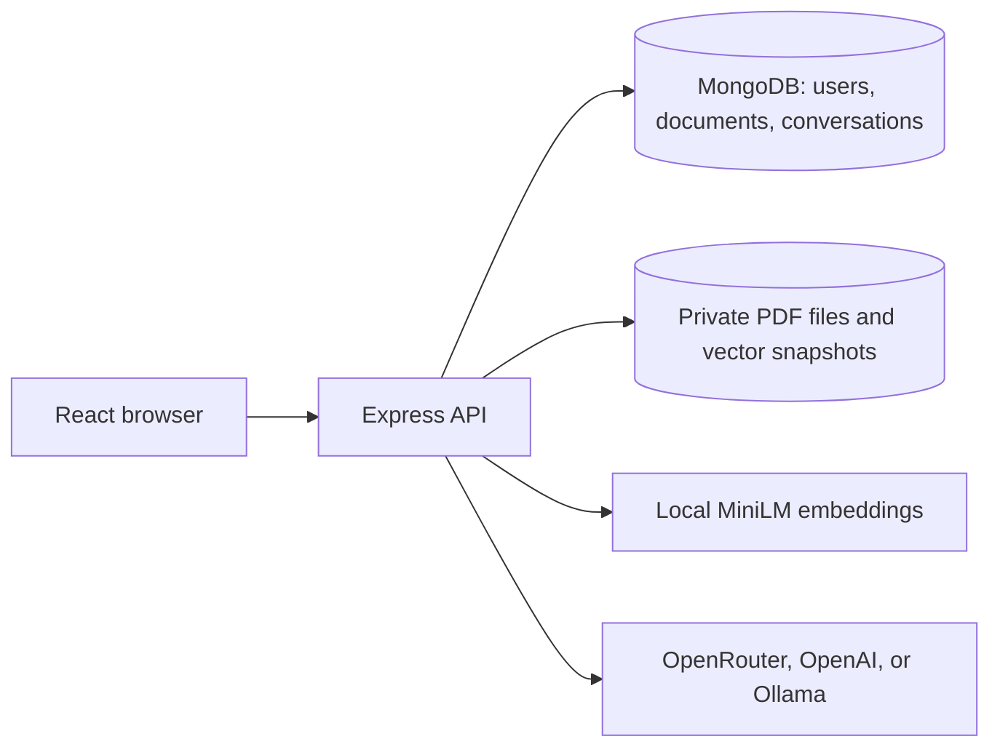

# Architecture

This is a modular monolith. Authenticated document and conversation routes filter by user ID. Each PDF is saved to private disk, parsed, split, embedded, and added to an exact cosine search index. The index is also snapshotted by user and document ID for restart recovery. One host with durable private storage is the current deployment assumption. See [optimization architecture](optimization/ARCHITECTURE.md) for limits and alternatives.
